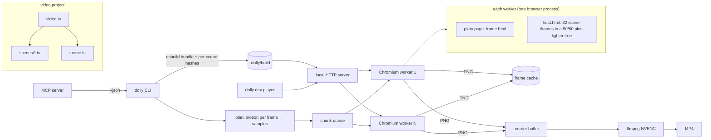

# Architecture

## The frame contract

A scene document (`frame.html` + the bundle) mounts the video and exposes `window.__dolly`:

- `render(t)`: set every animated property from `t` alone. The runtime also makes `Math.random`, `Date.now` and `performance.now` functions of `t`, freezes CSS animations, and hides inactive scenes with `display: none`.
- `motion(t0, t1)`: the largest on-screen displacement (output px) of anything visible between two times, plus the camera's share and direction. It drives adaptive blur, the player's velocity overlay and the static-span lint.
- `inspect(t)`: visible text with rects, rendered font size, colours, opacity and mask clipping, for lint and the player's overlays.
- `setSmear(dx, dy)`: blur the world layer along the camera direction (used past the sample cap).

The renderer, the player and the linter only ever talk to scenes through this object; a future native backend (Phase 4) implements the same contract.

## Rendering pipeline

1. **Bundle** with esbuild. A plugin stamps each `defineScene()` with its source file; esbuild's metafile gives each scene's transitive inputs, so every scene gets a content hash. Everything not owned by a scene (runtime, theme, world, assets) forms the global hash.
2. **Pool**: N Chromium processes (default ¾ of cores, max 16; measured knee at 12 on the 16-core laptop). One process per worker, because tabs in one browser share a compositor and serialise.
3. **Plan**: each worker measures `motion()` for its chunk of frames; samples per frame = next power of two of (motion / 1.5 px), capped at 32, max over ±2 frames. Cached per content hash.
4. **Render**: a shared queue of 30-frame chunks. Single-sample frames are captured from the plain page. Blurred frames go through the accumulation host: sub-frame times are computed in Node from integers, each leaf iframe renders one, the compositor averages them, and one screenshot comes out.
5. **Cache**: each frame's PNG is stored under a key of (renderer version, global hash, hashes of scenes active in its shutter interval, sample times, size, smear).
6. **Encode**: frames stream in order through a bounded reorder buffer into one ffmpeg (NVENC presets, BT.709 tagging), then the optional audio mux (ducking, two-pass loudnorm to −14 LUFS).

**Warm daemon** (`dolly daemon`, `packages/cli/src/daemon.ts`): one process per project keeps a session (bundle server + pool) open and runs the ordinary CLI commands in-process, streaming their stdout/stderr to the client as NDJSON, so output is byte-identical to a cold run. The CLI finds it through `<project>/.dolly/daemon.json` (port + token, loopback only) and falls back to starting browsers when there is none, it is stale, or the launch environment (`DOLLY_GPU`, `DOLLY_CHROME*`) differs; `--no-daemon` / `DOLLY_NO_DAEMON=1` opt out. Before each command `Session.refresh()` rebuilds (~40 ms) and reloads the workers' pages only if the bundle, aspect, size or blur-host size changed; a file watcher does the same in the background so the next command finds fresh pages. Commands run one at a time; a dead browser is replaced. **Fully cached renders** open a lazy session: scene metadata comes from `.dolly/cache/meta*-<hashes>.json` and no browser starts unless the plan or some frame is missing.

## Why these choices

See `docs/research.md` (decisions with sources) and `docs/benchmarks.md` (every number). The non-obvious ones:

- **Compositor-tree accumulation**: a flat stack of 1/N-opacity layers quantises every layer to 8 bits (28 dB at N=32). The binary tree of 50/50 blends keeps the error at ~0.7 levels for any N, and is 19× faster than capturing samples separately.
- **GPU memory budget** (`--force-gpu-mem-available-mb`): with 32 full-HD documents per host, Chromium's default tile budget silently drops layers.
- **No `will-change`, greyscale text AA, no low-res tiles**: each was a source of history-dependent pixels.
- **Residual raster noise**: Chromium still leaves a faint (≤ ~98 levels, edge-only) anti-aliasing difference on moving text depending on render history. The determinism check and golden tests separate that from real state bugs, which change pixels by more than half the range.

## Phase 4 plug-in points

- **Native GPU backend** (CanvasKit / skia-canvas / Vello): implement the frame contract (`render`, `motion`, `inspect`) outside Chromium and a `Worker` that returns RGBA. Validate with golden-frame diffs against the Chromium backend (the golden test harness already compares any PNG pair with the noise-aware criterion).
- **HTML-in-Canvas** (Chrome 157+): measured working here (`drawElementImage`, `texElementImage2D` with SRGB8_ALPHA8) but ~28 ms per sub-frame today; when that drops, it gives linear-light GPU accumulation and raw pixels without PNG.
- **Voice-over** (ElevenLabs etc.): a `vo` step that turns storyboard `vo` lines into audio files plus word timings, written as markers (`kind: "vo"`) and `audio` tracks; subtitles from the word timings. Never called without asking.
- **Beat detection**: a step that analyses the music track and writes `kind: "beat"` markers and `bpm`/`beatOffset`; the player's snap and the cut-on-beat lint already read them.
